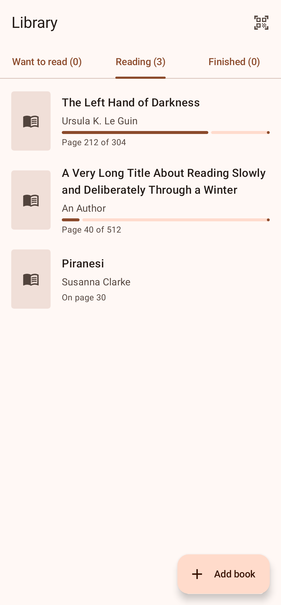
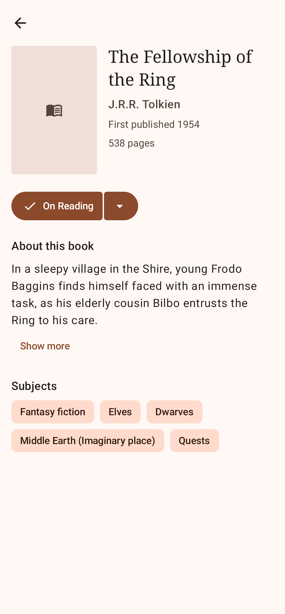
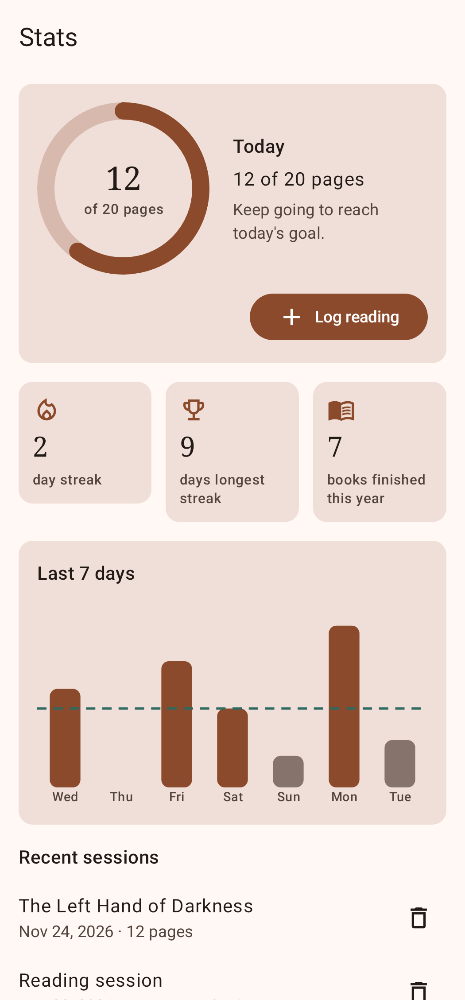
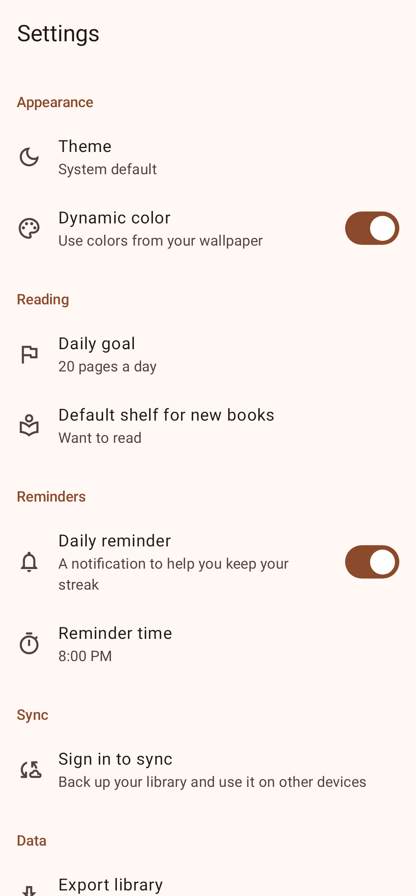
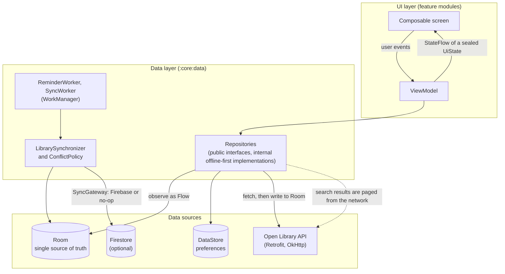
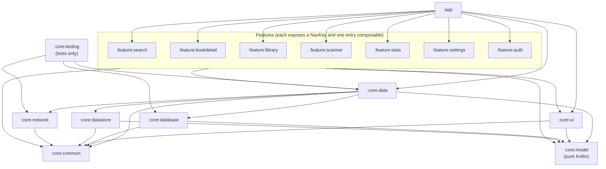

# Shelf

Shelf is an offline-first Android book tracker. Search for books (Open Library, no API key) or
scan the barcode on the back of one, keep them on three shelves (Want to read, Reading,
Finished), track your progress and ratings, log what you read each day against a daily goal
with a reminder, and optionally sign in with Google to sync the library between devices.
Everything except search and sign-in works without a network connection.

| Library | Book | Stats | Settings |
|---|---|---|---|
|  |  |  |  |

The images are the reference images of the screenshot tests (see [Tests](#tests)).

## Features

- **Search** by title or author with a 400 ms debounce, paging, recent searches, and loading,
  empty, error and append states.
- **Book details** with cover, authors, first publication year, description, subjects and page
  count, cached in Room so a book you have opened before also opens offline. A split button adds
  the book to a shelf or moves it; adding and removing can be undone.
- **Barcode scanner** (CameraX and ML Kit, EAN-13/EAN-8) with a viewfinder, flashlight, haptic
  feedback, careful camera-permission handling and manual ISBN entry. A scanned book opens its
  details or goes straight onto your default shelf.
- **Library** with one tab per shelf, progress bars, a page per book (current page, rating,
  shelf, notes), a rating prompt when a book is finished, and swipe to remove with Undo.
- **Reading log and stats**: today's progress ring against the daily goal, current and longest
  streak, books finished this year and a 7-day bar chart drawn on a Canvas (with a text
  alternative for screen readers).
- **Daily goal and reminder**: pages or minutes; a daily notification at the time you choose;
  tapping it opens the "Log reading" sheet (`shelf://log`).
- **Settings**: theme, dynamic color, reminder, goal, default shelf, export of the whole library
  as JSON through the system file picker, and the account.
- **Optional sync**: Google sign-in (Credential Manager and Firebase Auth) and Firestore sync with
  last-write-wins conflict resolution. Without a Firebase configuration the app builds and runs
  with sync turned off.

## Architecture

Shelf follows Google's [guide to app architecture](https://developer.android.com/topic/architecture):
a UI layer and a data layer, unidirectional data flow, and Room as the single source of truth.



- Each screen has one ViewModel exposing a `StateFlow` of a sealed `UiState`, collected with
  `collectAsStateWithLifecycle`. One-off events (snackbars, "close this screen", a pending deep
  link) are part of the state and acknowledged by the UI.
- Screens never see network results directly. Book details are fetched into Room and the screen
  observes Room. Search results are the one exception: they are paged straight from Open Library
  with Paging 3 and not stored.
- Every local write marks the row dirty and asks for a sync. The sync worker does nothing when
  the user is signed out or the build has no Firebase configuration.
- Dispatchers are injected with a qualifier so tests can replace them.

### Modules



Features depend only on core modules, never on each other; `:app` wires navigation (Navigation 3
with a serializable back stack per tab) and the deep links `shelf://book/{workKey}` and
`shelf://log`. Repositories are interfaces in `:core:data` whose implementations are `internal`
and bound with Hilt. Shared build configuration lives in convention plugins in `build-logic/`.

| Module | Contents |
|---|---|
| `:app` | `MainActivity`, navigation, adaptive navigation bar/rail, splash, onboarding, Hilt application, Firebase wiring |
| `:core:model` | Domain models (`Book`, `ShelfEntry`, `ReadingLog`, `DailyGoal`, ...) and ISBN validation; no Android |
| `:core:common` | Dispatcher qualifiers, application scope, `ShelfResult`/`ShelfError`, time utilities, deep link patterns |
| `:core:network` | Retrofit service, DTOs, error classification, OkHttp with a 10 MB cache and a User-Agent |
| `:core:database` | Room entities, DAOs, migrations, schemas in `core/database/schemas` |
| `:core:datastore` | Preferences DataStore wrapper |
| `:core:data` | Repositories, mappers, paging source, export, reminders, sync, auth |
| `:core:ui` | Theme (with a hand-made fallback palette), icons, shared components, `UiText` |
| `:core:testing` | Fakes, test data, dispatcher rule, in-memory database, Turbine helpers |
| `:feature:*` | One screen (or a few related ones) each, with ViewModels and tests |

## Running the app

Requirements: JDK 21 for Gradle, and the Android SDK with **platform 37.2** and **build-tools
37.0.0** (`sdkmanager "platforms;android-37.2" "build-tools;37.0.0"`).

```bash
./gradlew assembleDebug   # builds without any secret files
./gradlew installDebug    # on a device or emulator (API 26+)
```

A release build is minified with R8 and shrinks resources. Without signing secrets it is signed
with the debug key so that it can be installed and tested locally:

```bash
./gradlew assembleRelease
```

### Enabling Firebase (sign-in and sync)

The app builds and runs without Firebase. To turn sync on:

1. Create a Firebase project and add an Android app with the package name `com.example.shelf`.
   Add the SHA-1 of your signing key (`./gradlew signingReport` shows the debug one).
2. In **Authentication**, enable the **Google** sign-in provider.
3. Create a **Cloud Firestore** database and publish the rules in
   [`firebase/firestore.rules`](firebase/firestore.rules), which let each user read and write only
   `users/{uid}/books` and `users/{uid}/logs`.
4. Download `google-services.json` into `app/` (the file is git-ignored; see
   [`app/google-services.json.example`](app/google-services.json.example) for its shape).
5. Build again. The Google Services and Crashlytics plugins are applied only when the file exists,
   and the Google web client id is read from it at build time.

Crashlytics only collects from release builds.

## Tests

| Command | What it runs |
|---|---|
| `./gradlew test` | Unit and Robolectric tests: use cases, mappers, repositories, DAOs, the migration, ViewModels (with Turbine), workers, MockWebServer API tests and Compose UI tests |
| `./gradlew check` | `test` plus Android lint, detekt and Spotless (ktlint) |
| `./gradlew coverageReport -Pcoverage.minimum=0.7` | JaCoCo line coverage per module and for all ViewModels; fails below 70 % for `:core:data` or the ViewModels |
| `./gradlew validateDebugScreenshotTest` | Compose Preview Screenshot Tests (Library, Book detail, Stats, Settings in light, dark and font scale 1.3) |
| `./gradlew updateDebugScreenshotTest` | Records new reference images after an intended UI change |
| `./gradlew connectedDebugAndroidTest` | Accessibility Test Framework checks on a device or emulator with API 34+ |
| `./gradlew spotlessApply` | Formats the code |

Screenshot references were recorded on Windows. Font rendering differs slightly between
operating systems, so validation is not part of `check`; re-record the references on the
machine that validates them.

**Testing the scanner on an emulator.** The emulator's virtual camera scene can show any image as
a poster. Start the emulator with an image of an EAN-13 book barcode, then walk the camera to it:

```bash
emulator -avd <avd> -virtualscene-poster wall=/path/to/isbn-barcode.png
adb emu automation play "$ANDROID_HOME/emulator/resources/macros/Walk_to_image_room"
```

## Continuous integration and releases

- [`.github/workflows/ci.yml`](.github/workflows/ci.yml) runs on pull requests and on `main`:
  Spotless, detekt, lint, unit tests, the coverage gate and `assembleDebug`, and uploads the APK
  and reports.
- [`.github/workflows/release.yml`](.github/workflows/release.yml) runs on version tags (`v1.0.0`):
  it restores the keystore from secrets, runs the checks, builds a signed App Bundle, verifies the
  signature, uploads it with the R8 mapping file and creates a GitHub release. Secrets:
  `SHELF_KEYSTORE_BASE64`, `SHELF_KEYSTORE_PASSWORD`, `SHELF_KEY_ALIAS`, `SHELF_KEY_PASSWORD`, and
  optionally `GOOGLE_SERVICES_JSON` to ship with sync enabled. No keystore is in the repository.

## Known limitations

- **Sync has not been run against a live Firebase project** while building Shelf (no
  credentials were available). The sync logic is covered by tests with an in-memory gateway that
  applies the same last-write-wins rules, and a build with a placeholder configuration was checked
  up to the Google account picker.
- Conflicts are resolved per book and per log by the time of the edit on the device that made it,
  so a device with a badly wrong clock can win or lose a conflict it should not. Changes are found
  by server time, so clock skew never hides a change.
- Deletions are kept as tombstones for 30 days. A device that stays offline for longer can miss
  a deletion.
- Preferences and the goal history are not synced; the library and the reading log are.
- Searching needs a connection; everything else works offline.
- The scanner looks up ISBN-13 (Bookland EAN-13) barcodes. Older ISBN-10 books can be typed in.
- Export only; there is no import yet.
- Large screens get a navigation rail but no two-pane layouts.
- Screenshot tests and the accessibility checks are not run in CI (see [Tests](#tests)).

Decisions that the specification left open, and the places where the build deviates from it,
are recorded in [docs/DECISIONS.md](docs/DECISIONS.md).
